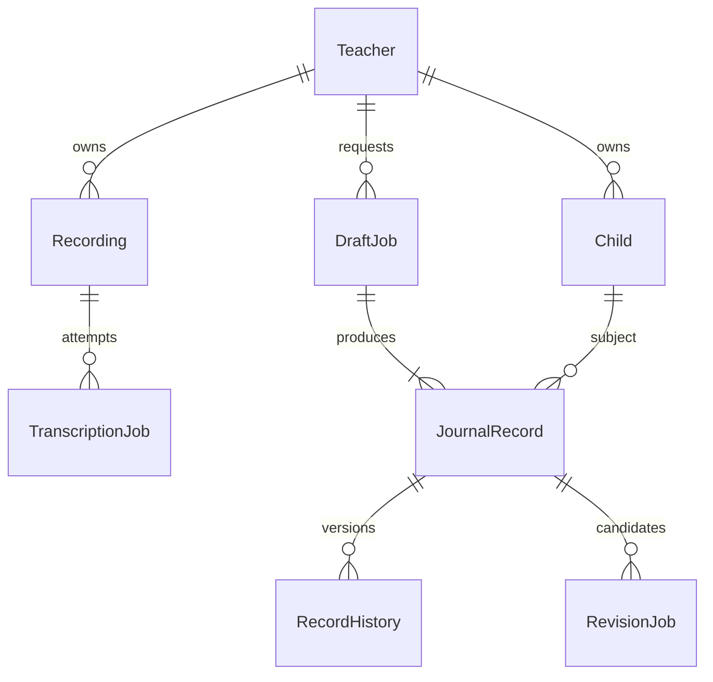

# MVP API 계약 통합 (BE-10)

이 문서는 현재 `/openapi.json`과 함께 앱 연결에 사용하는 계약 정본이다. `SPEC.md` 3·5-1절의 MVP 결정과 BE-00~10의 기능 계약을 정리한다. 로그인·세션·아동 명단은 실제 SQLite와 연결했다. 원음 저장·인증 재생·삭제도 실제 연결했다. 작업 큐·외부 STT/일지 AI는 미연결이며 해당 업무 서비스는 501이다.

## 전체 경로

다음 정상 상태 코드는 실제 업무 서비스 연결 후 사용할 응답 계약이다. 현재 `/health`는 200이고, 보호 경로의 인증 누락은 401이다. 등록 계정의 로그인·명단 API는 정상 응답을 반환한다. 만료·변조·폐기 토큰은 401이며 녹음은 실제 저장소를 사용하며 전사·일지의 기본 업무 서비스는 501이다. 올바르지 않은 입력은 공통 422 계약을 따른다. 가짜 서비스의 정상 응답을 실기능 완료로 해석하지 않는다.

| 메서드 | 경로 | 정상 상태 계약 | 인증 | 기능 |
|---|---|---|---|---|
| `GET` | `/health` | 200 | 공개 | 서버 상태 확인 |
| `POST` | `/api/v1/auth/login` | 200 | 공개 | 테스트 계정 로그인 |
| `POST` | `/api/v1/auth/logout` | 204 | Bearer | 현재 세션 폐기 |
| `GET` | `/api/v1/auth/me` | 200 | Bearer | 내 교사 계정 조회 |
| `GET` | `/api/v1/children` | 200 | Bearer | 내 아동 명단 조회 |
| `POST` | `/api/v1/children` | 201 | Bearer | 아동 등록 |
| `PATCH` | `/api/v1/children/{child_id}` | 200 | Bearer | 아동 이름 수정 |
| `POST` | `/api/v1/children/{child_id}/deactivate` | 200 | Bearer | 아동 비활성화 |
| `POST` | `/api/v1/recordings` | 201 | Bearer | 녹음 파일 업로드 계약 |
| `GET` | `/api/v1/recordings` | 200 | Bearer | 내 녹음 목록 계약 |
| `GET` | `/api/v1/recordings/{recording_id}` | 200 | Bearer | 내 녹음 상세 계약 |
| `DELETE` | `/api/v1/recordings/{recording_id}` | 204 | Bearer | 녹음 삭제 계약 |
| `GET` | `/api/v1/recordings/{recording_id}/audio` | 200 | Bearer | 인증된 비공개 녹음 재생 계약 |
| `POST` | `/api/v1/recordings/{recording_id}/transcriptions` | 202 | Bearer | 외부 전사 요청·실패 재시도 |
| `GET` | `/api/v1/transcription-jobs/{job_id}` | 200 | Bearer | 전사 작업 상태·결과 조회 |
| `GET` | `/api/v1/recordings/{recording_id}/transcriptions/latest` | 200 | Bearer | 녹음의 최신 전사 작업·결과 조회 |
| `POST` | `/api/v1/drafts` | 202 | Bearer | 선택 녹음과 전체 명단으로 관찰일지 초안 생성 |
| `GET` | `/api/v1/drafts/{draft_id}` | 200 | Bearer | 초안 작업 상태·아동별 결과 조회 |
| `GET` | `/api/v1/records` | 200 | Bearer | 이전 관찰일지 목록·필터 |
| `GET` | `/api/v1/records/{record_id}` | 200 | Bearer | 관찰일지 상세 |
| `PATCH` | `/api/v1/records/{record_id}` | 200 | Bearer | 직접 수정문 그대로 저장 |
| `POST` | `/api/v1/records/{record_id}/confirm` | 200 | Bearer | 교사 문구 그대로 확정 |
| `GET` | `/api/v1/records/{record_id}/history` | 200 | Bearer | 일지 버전·수정 이력 |
| `POST` | `/api/v1/records/{record_id}/revisions` | 202 | Bearer | AI 수정 후보 비동기 요청 |
| `GET` | `/api/v1/records/{record_id}/revisions/{revision_id}` | 200 | Bearer | 수정 후보 상태·결과 |
| `POST` | `/api/v1/records/{record_id}/revisions/{revision_id}/adopt` | 200 | Bearer | 수정 후보 채택·재검토 |

Swagger UI는 `/docs`, OpenAPI JSON은 `/openapi.json`에서 제공한다. 알려지지 않은 `/api/v1/*`는 기존 501 폴백이며 스키마에는 노출하지 않는다. `/health`, 로그인 외의 업무 경로는 Bearer를 사용한다. 별도 회원가입·공개 공유 링크·공유/발송 API는 없다.

## 인증과 오류

로그인은 JSON `{login_id,password}`를 받으며, 이후 `Authorization: Bearer <access_token>`을 사용한다. 비밀번호는 Argon2id 해시, 접근 토큰은 해시와 만료 시각으로 SQLite에 보관한다. 기본 세션은 7일이며 `POST /auth/logout`은 현재 토큰을 폐기하고 204를 반환한다. 계정 준비는 [BE 실행 안내](../../README.md)를 따른다. 정상 로그인 응답 모델은 `{access_token,token_type:"bearer",expires_in,teacher:{teacher_id,display_name}}`이다. 아래 계정/토큰/이름/ID는 문서용 가상 데이터다.

```json
{"login_id":"teacher-demo","password":"demo-password-only"}
```

```json
{"access_token":"example-token","token_type":"bearer","expires_in":3600,"teacher":{"teacher_id":"T_DEMO","display_name":"가상 교사"}}
```

인증된 교사만 소유자를 결정하고 서비스/저장소의 모든 조회·쓰기에도 교사 ID를 전달한다. 추가 teacher_id로 접근 범위를 변경하지 않는다. 다른 교사의 자료는 404다. 요청 본문은 추가 필드를 거부하며, 목록 쿼리의 알려지지 않은 값은 무시한다.

```json
{"error":{"code":"NOT_IMPLEMENTED","message":"이 기능은 아직 구현되지 않았습니다.","details":{"path":"/api/v1/future-feature"}}}
```

| 상태 | 용도 |
|---|---|
| 401 | UNAUTHENTICATED / INVALID_CREDENTIALS / INVALID_TOKEN; WWW-Authenticate: Bearer 유지 |
| 404 | 없는 자료·삭제된 녹음·다른 교사 자료·다른 일지의 수정 후보 |
| 409 | 미완료 녹음 선택·중복 전사·오래된 버전/후보·미완료 후보 채택 |
| 415 | 선언 MIME 미지원·실제 오디오 형식 불일치·해독 실패 |
| 422 | 요청/날짜/페이지/추가 입력 오류; 잘못된 생성 참조는 작업에서 validation 실패로 처리 |
| 500 | 예상하지 못한 서버 오류; 입력 원문을 본문에 복사하지 않음 |
| 501 | 전사·일지 업무 서비스 미연결 또는 미구현 경로 |

## BE-08 이전 기록 목록

`GET /recordings`는 녹음 시각(recorded_at), `GET /records`는 최초 일지 생성 시각(created_at) 기준이다. 실제 접두사는 `/api/v1`이다.

| 쿼리 | 의미 |
|---|---|
| date_from/date_to | YYYY-MM-DD, Asia/Seoul 달력 날짜, 양 끝 포함; 한쪽만 지정 가능 |
| limit | 1~100, 기본 20 |
| offset | 0 이상, 기본 0 |
| order | desc 기본/asc; 시각 다음 고정 ID를 같은 방향으로 정렬 |
| child_id | 일지에만 사용; 비활성 아동의 과거 기록 포함 |
| status | 일지에만 사용; 작성중/검토중/완료 |

소유자 범위·삭제 제외·필터·정렬을 먼저 적용한 다음 페이지를 자른다. total은 페이지 전 필터 결과의 전체 수다. 날짜를 UTC 자정으로 잘라 한국 날짜의 첫/마지막 기록을 누락하지 않는다. created_at은 서버가 최초 생성 저장에서 한 번 정하고 수정·확정·후보 채택 시 보존한다. 잘못된 날짜·역전 범위·페이지 값·일지 상태는 422다.

```http
GET /api/v1/records?date_from=2026-11-01&date_to=2026-11-02&child_id=C01&status=완료&limit=20&offset=0&order=desc
```

빈 목록·빈 필터·범위 밖 페이지는 모두 200이다. 실제 저장소 미연결 시에는 빈 목록으로 가장하지 않고 501이다.

```json
{"items":[],"total":0,"limit":20,"offset":0}
```

범위 밖 페이지는 items가 비어도 total은 필터 결과 수를 유지한다. 일지 목록은 ID·아동·상태·버전·생성/확정 시각·can_share 요약만 포함한다. 전사문·근거 전체·일지 본문은 상세에서 조회한다. 기존 녹음 목록의 `{items}` 응답은 이번 BE-08에서 페이지 메타데이터를 추가했고 서비스/저장소 list 인터페이스도 query + page 반환으로 확장했다. 기존 테스트 대체 서비스와 빈 목록 기대값을 이 계약 변경에 맞춰 수정했다.

## BE-09 복사·OS 공유

일지 상세의 can_share와 share_text는 현재 상태에서 계산하는 읽기 전용 필드다.

| 현재 상태 | can_share | share_text |
|---|---|---|
| 작성중/검토중 | false | null |
| 완료 | true | 현재 교사 확정문 edited_text 그대로 |

```json
{"record_id":"J1","version":2,"status":"완료","can_share":true,"share_text":"  최종 확정문\n공백과 줄바꿈 보존  "}
```

공유 직전에 앱은 상세를 다시 조회해 상태/버전을 확인하고 사용자의 복사 또는 OS 공유 동작에 share_text를 전달한다. 공유 응답 생성은 일지 변경·AI 호출·발송을 하지 않는다. 실제 OS 공유 UI는 React Native + Expo 앱 작업이다. 확정 후 직접 수정하거나 새 후보를 채택하면 검토중으로 바뀌므로 can_share:false/share_text:null이다. 조회 후 다른 기기에서 수정되는 경합과 이미 복사된 문자열은 서버가 회수할 수 없으며, 읽기 전용 계약은 외부 발송 트랜잭션을 뜻하지 않는다.

## 논리 데이터 관계

아래는 인터페이스를 설명하는 논리 관계이며 실제 DB 테이블/마이그레이션이 아니다.



- child_id: 실명 명단과 연결하는 고정 서버 ID. 비활성화해도 과거 참조 유지.
- recording_id: 원음과 녹음 메타데이터. 삭제 후 신규 전사/생성/재생 접근 차단.
- job_id: 전사·생성·수정의 비동기 실행 시도. queued/running/completed/failed.
- draft_id: 전체 명단과 선택 전사문/관찰을 고정한 생성 묶음.
- record_id: 한 아동의 일지. 작성중/검토중/완료 상태는 작업 상태와 구분.
- observation_id: 선택 녹음에서 추출한 근거. 공통/개별/공동/불명확과 아동 참조를 검사.
- revision_id: 기존 본문을 바꾸지 않는 후보. 원래 본문·아동·근거·base_version 고정.
- version/expected_version: 본문·확정·채택의 충돌 방지. 버전/이력 저장은 원자적 처리.

생성 스냅샷은 명단·선택 전사문·근거를 불변 값으로 보존한다. 원음 삭제와 이미 만든 일지/근거 보존을 구분한다. 직접 수정/확정은 제출 문구를 그대로 저장하고, AI 재요청은 새 후보만 만든다. 후보 채택은 base/current 버전을 검사하고 검토 상태로 되돌린다. 작업 예약/claim/완료/실패 및 일지 이력은 실제 저장소에서 원자적으로 구현해야 한다.

## 알림장 기반 관찰일지 v2

알림장 날짜와 녹음 시작일(Asia/Seoul)이 일치하는 원음만 선택할 수 있다. 목록·재생은 인증된 v1 녹음 경로를 재사용한다. `/api/v2/sessions/{session_id}/recording-drafts` 작업을 시작하면 선택한 녹음만 전사하고, 이미 전사한 파일은 결과를 재사용한다. 직접 입력·아동 정보·전사문을 검토해 필요한 질문만 낸다. 최초 생성은 검토용 초안을 만들고, 기존 알림장의 재생성은 아이별 후보를 보관했다가 명시적 반영 요청에서만 현재 본문을 교체한다. 반영할 때 아동과 본문 버전을 검증하고 이전 버전은 이력에 남긴다.

관찰 추출은 원문 인용과 전사문에 적힌 이름을 함께 돌려준다. 이름이 한글 자모 하나만 다른 경우에도 출석한 후보 한 명으로 좁혀지고 AI가 제안한 대상과 일치하면 그 아이로 연결한다. 결석을 포함한 반 명단에 비슷한 후보가 여럿이거나 대상이 불명확하면 확인을 받는다. 같은 추출 호출에서 당일 교사 메모를 참고해 명백한 전사 오기의 짧은 교정도 제안한다. 같은 구절이 여러 번 나오면 원문 인용 안의 등장 순서로 바꿀 위치를 지정한다. 원본 전사문과 근거 인용은 보존하고, 검토·작성에 전달하는 관찰 문장에서만 검증된 교정과 등록 이름을 사용한다. 같은 녹음의 근거는 전사문에 등장한 순서대로 전달한다.

서버의 `PATPAT_STT_URL`에 전사 API 주소를 설정한다. 제공자가 요구할 경우 `PATPAT_STT_API_KEY`와 `PATPAT_STT_MODEL`도 서버에 설정한다. 요청은 녹음 파일을 multipart의 `file`로 보내고 응답의 `text`를 사용한다. 테스트는 `create_app(speech_to_text=...)`로 제공자를 주입할 수 있다. 가상 데이터 검증에서는 `PATPAT_AI_PROVIDER=fake`와 `PATPAT_DEMO_TRANSCRIPT`를 함께 설정해 고정 전사문을 사용할 수 있다. 전사 제공자와 가상 전사문이 모두 없으면 `STT_NOT_CONFIGURED`를 반환한다.

앱에서 관찰영역은 초안 요청 전 교사가 확인한다. `POST /api/v2/sessions/{session_id}/generate?manual_areas=true&prepare_journals=true`는 영역을 비워 두어도 작성에 필요한 맥락과 장소·시간을 검토하며, 영역을 추천하거나 역질문으로 묻지 않는다. 같은 세션에서 아이별 초안을 다시 만들 때도 교사가 확인한 영역을 사용한다.

확정을 취소한 알림장의 본문이 직전 확정문과 다르면 상세 응답의 `needs_journal_update_choice`가 true다. `POST /api/v2/notices/{notice_id}/confirm`에는 `update_journal`로 교사의 선택을 보낸다. false이면 관찰일지 본문을 유지하고, true이면 새 확정문으로 해당 아동·날짜의 본문을 다시 작성한다. 새 본문을 작성하는 데 성공하면 직접 수정한 날짜별 본문도 교체된다.

교사가 날짜별로 이어진 본문을 편집할 수 있도록 `GET /api/v2/children/{child_id}/journal`의 `days`는 확정된 관찰을 아이와 날짜별로 모아 돌려준다. `PATCH /api/v2/children/{child_id}/journal`은 수정한 날짜의 `observed_date`, `content`, `expected_revision`을 받아 한 번에 저장한다. 날짜별 수정문은 원본 관찰 행과 별도로 보관하므로 장소·시간·영역과 알림장 근거를 유지한다. 저장한 수정문은 텍스트 출력과 `GET /api/v2/journal/archive`의 날짜별 보관함에 반영된다. 보관함은 확정 취소된 기록을 제외하고 명단에서 비활성화한 아이의 과거 기록을 포함한다.

`GET|POST|DELETE /api/v2/teacher/journal-template`은 교사 계정의 공통 Word 양식 하나를 조회·교체·제거한다. 업로드는 `POST ?filename=...`에 5MB 이하의 원본 파일 바이트를 보낸다. 이전 `PUT` multipart의 `file`도 받는다. 일반 `.docx`는 원본을 저장하고 `.doc`, `.dotx`, `.dot`, `.docm`, `.dotm`, `.rtf`, `.odt`, `.ott`, Word `.xml`, `.fodt`는 LibreOffice Writer로 `.docx`로 변환한다. `.word` 파일은 내부 형식이 지원되는 경우에 받는다. 서버의 `PATH`에서 `soffice`를 찾으며, 실행 파일은 `PATPAT_WORD_CONVERTER`로 지정할 수 있다.

`POST /api/v2/children/{child_id}/journal/output`은 아동·조회 기간별 텍스트 미리보기와 양식 등록 여부를 반환한다. `POST /api/v2/children/{child_id}/journal/output/word`를 요청하면 미리보기의 기간과 `revision`에 맞는 Word 파일을 생성하거나 저장된 파일을 반환한다. AI는 Word 파일을 처음 생성할 때만 `record_format`과 양식의 항목·빈칸을 보고 입력 위치를 고르고, 서버가 저장된 값을 채운다. 본문이나 양식이 바뀌면 관찰일지 조회에서 `output_stale`을 반환한다. 텍스트 재출력은 기존 Word 파일에 영향을 주지 않으며, Word 출력이 성공하면 Word 파일을 교체한다. `GET /api/v2/children/{child_id}/journal/output/word`는 저장된 파일만 내려준다.

테스트 문장 모드는 정해진 항목명과 바로 옆 또는 다음 문단의 빈칸을 연결한다. 관찰내용 입력 위치를 확인할 수 없으면 Word 파일을 생성하지 않는다.

## 문서 적용 범위와 남은 구현

사용자의 MVP 결정(외부 STT, 가명 처리 생략, 서버 명단/원음, 관찰일지 우선)은 SPEC 3·5-1절과 AGENTS 및 이 계약을 따른다. 초기 알림장/로컬 처리 도메인은 후속 설계 기록이다. AC4의 알림장 special_notes와 AC6의 로컬 가명 처리 범위를 현재 관찰일지 계약에 그대로 적용하지 않는다. 생성 사실 보존·아동 분리·교사 확정 기준과 기존 golden_cases.yaml 기대값은 유지했다.

기능별 상세: [명단](CHILDREN.md), [녹음](RECORDINGS.md), [전사](TRANSCRIPTIONS.md), [작성/수정/확정](WRITING.md). 실행은 [README](../../README.md)를 따른다. OpenAPI는 앱에서 직접 생성하므로 별도 JSON 사본을 저장하지 않는다.

인증·명단의 SQLite 저장과 앱 연결은 구현했다. 아직 실제 구현이 필요한 항목은 녹음·일지 저장소와 트랜잭션, 비공개 원음 보관/삭제/검증, 작업 큐, STT 공급자, 관찰 추출/일지 AI 공급자, 앱의 녹음·측면 버튼·공유 UI다. 골든 케이스의 실제 AI 품질/독립 의미 판정도 미실행이다.

목록 쿼리는 [FastAPI Query Parameter Models](https://fastapi.tiangolo.com/tutorial/query-param-models/)로 검증한다. 테스트 대체 서비스로 API·소유권·필터 위임·상태·문구를 검증한 결과는 실제 DB 검색 성능/격리/외부 AI/OS 공유 검증과 구분한다.

기존 골든 케이스의 input은 초기 `/drafts`의 child_ids/observation_ids 형식이다.
현재 `/api/v1/drafts`의 recording_ids API를 검증하려면 같은 관찰을 선택 녹음의
fixture로 옮기는 입력 어댑터가 필요하다. 기대 사실·금지 사실·아동 분리·누락
판정은 유지하고, 현재 API 테스트 통과를 그 어댑터/실제 AI 실행으로 보고하지 않는다.

## 최종 검증 기록 (2026-11-02)

`python -m pytest -q`: 187개 통과. 기존 계약과 목록 필터·페이지·소유권,
공유 문구/재수정 시 해제, OpenAPI 전체 인증/오류·문서 경로 일치를 확인했다.
`python -m compileall -q app`, `git diff --check` 및 ontology/golden YAML
구문 점검도 통과했다. 실제 DB·외부 API·OS 공유·AI 의미 품질은 미검증이다.


## 로그인·명단 실구현 검증 (2026-11-04)

실제 임시 SQLite와 인증·명단 서비스를 포함해 BE 테스트 196개가 통과했다. 서버 재시작 후 세션/명단 유지, 잘못된 비밀번호·만료/변조/폐기 토큰, 비활성 계정, 다른 교사 접근 차단, 동명이인·고정 ID·비활성화 반복·동시 등록을 검사했다. 기존 인증의 501 전제 검사만 실제 401 계약으로 갱신했으며 골든 케이스 기대값은 변경하지 않았다. FE 클라이언트와 실제 서버의 통합 검사도 통과했다. 외부 AI·실기기 검증과 구분한다.
