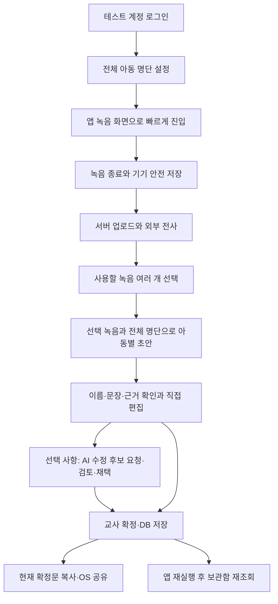

# PatPat MVP 실구현·FE/BE 통합 계획

- 작성일: 2026-11-03
- 목적: 산출물 전체의 목표·변경 결정·구현 상태를 대조해 다음 구현 순서를 정한다.
- 상태: 권장 계획. 제품 코드·기존 정본·기존 테스트는 이번 계획 작업에서 수정하지 않았다.
- 기준: 사용자 대화의 확정 결정 → 문제/온톨로지의 사실 보존 원칙 → 현재 SPEC의 MVP 절 → FE/BE 공동 API 계약 → 이전 계획/발표자료 순서로 충돌을 해소한다.
- 저장소: main에 FE/BE가 병합돼 있다. 기존 AGENTS/PROBLEM/SPEC/ontology의 미커밋 변경은 그대로 보존한다.

## 1. 권장 방향

**서버가 명단·녹음·관찰·일지의 기준 데이터를 관리하고, 앱은 녹음·편집·검토·공유에 집중하는 관찰일지 MVP를 완성한다.**

React Native + Expo와 Python/FastAPI를 유지한다. 최초 저장은 기기에서 안전하게 마치고 서버로 업로드하며, 외부 STT·관찰 추출·일지 AI는 서버에서 실행한다. SQLite에는 계정·메타데이터·전사문·근거·일지·작업/수정 이력을, 비공개 파일 영역에는 원음을 둔다. 키는 서버에서 관리한다. 사용자 결정대로 MVP에서는 가명 처리를 생략한다.

기존 세 탭의 화면·녹음 제어·파일 보존·후보 비교·확정 후 공유 원칙을 재사용한다. 작업 단위는 실제 저장소와 앱을 함께 연결한 사용자 흐름이다. 기능의 완료 기준은 501 라우터/대체 서비스가 아니라 저장·재조회·실제 처리 성공이다.

## 2. 산출물이 말하는 현재 상태

| 근거 | 확인한 내용 | 계획에 반영할 점 |
|---|---|---|
| 루트 README | 기획/조사 예정, 두 기록 지원, 로컬 전사·가명 처리 필수로 남음 | 현재 구현 상태와 관찰일지 MVP로 갱신 필요 |
| 설문·워크플로·PROBLEM | 아이별 회상/한 문장 작성/표현 검토 부담, 확인 안 되는 사실은 제외 | 짧게 기록하고 근거를 확인해 확정하는 흐름을 핵심으로 유지 |
| ontology | Teacher–Child–Observation–Journal과 사실/아동 분리·교사 확정 규칙 | Recording/Job은 처리·저장 구조이며 Observation 사실을 대신하지 않음 |
| 발표 PDF | 핵심 조사/온톨로지/사실 보존 가설, 로컬 처리·알림장도 포함한 과거 설계 | 연구 근거로 사용하고 현재 MVP 기술 결정과 구분 |
| 10.28 실습 메모 | 녹음/선택/작성/재요청/공유/이전 기록, 개발 후 RAG | 현재 범위와 부합; 메모의 로컬 전사는 이후 사용자 변경 결정 우선 |
| FE README/계획/검증 기록 | 실제 기기 파일용 녹음·보관함 코드, 작성 UI/대체 연결, 실제 기기 검증 대기 | UI 유지, 서버 연결과 실기기 검증 필요 |
| FE 작성 타입/컨트롤러 | local prepare + privacyVerified + observation_ids, 화면 자체 버전 | 새 서버 계약과 처리 책임으로 전환 필요 |
| BE README/계약/코드 | 21개 경로·25개 작업의 계약, 기본 업무 서비스 501 | 실제 계정/DB/파일/큐/AI 구현 필요 |
| golden_cases/spike | 사실·아동·근거·누락의 판정 조건, 실제 AI 실험 미실행 | 기존 기대값을 보존하고 실제 파이프라인 평가로 연결 |

FE 123개, BE 187개 통과는 기존 기록과 이전 실행 결과다. 이번 계획 작업에서는 제품 테스트를 재실행하지 않았다. 가상 파일/대체 서비스 통과와 실제 DB·마이크·외부 AI·OS 공유 검증은 구분한다. 사진 정리, 상담/발달 진단, 알림장, RAG, 기기 내 전사는 현재 우선 작업에 추가하지 않는다.

## 3. 완료할 사용자 흐름

서버 업로드/전사는 녹음 종료 후 이어서 처리한다. 네트워크 실패 때 기기 저장 성공과 서버 저장 실패를 분리해 보여 주고 원음을 보존한다. 초안 생성 전 선택 항목이 모두 서버에 업로드되고 전사 완료인지 확인한다. 일부 실패 항목을 몰래 제외해 생성하지 않는다.

보관함의 녹음 행은 로컬 파일과 업로드 상태를 함께 표현한다. 업로드된 행에는 recording_id를 연결하고, 서버만 있는 과거 녹음은 인증된 다운로드/재생 경로로 처리한다. 목록/선택/삭제가 서로 다른 데이터 집합을 보지 않게 한다.

## 4. 온톨로지에서 고정할 기준

1. 파일 URI/파일명은 녹음 위치다. recording_id, observation_id, record_id와 혼용하지 않는다.
2. STT 전사문은 원음의 기계 전사 결과다. 이름/아동/사실이 검증됐다는 의미로 취급하지 않는다.
3. 관찰은 전사문에서 추출하되 common/individual/joint/unresolved를 구분한다. 이름 오류·동명이인·대상 불명확은 추측해 배정하지 않는다.
4. 아동별 문장은 해당 아동의 individual/joint 근거만 사용한다. 공통 활동만 있는 아동에게 개별 행동을 만들지 않는다.
5. 생성 시 전체 활성 명단과 선택 근거를 고정한다. 근거 없는 아동은 확인 필요와 빈 개별 문장으로 남긴다.
6. 관찰/배움 읽기/놀이 지원/지원 계획 중 입력으로 뒷받침되는 항목만 만든다. 부상·부정·정정·교사 조치의 의미를 바꾸지 않는다.
7. 교사의 편집문을 최종 본문으로 삼고 저장·확정·후보 채택에서 AI를 다시 호출하지 않는다.
8. 후보는 별도 자원이다. 채택해도 검토중이며 다시 교사가 확정해야 공유할 수 있다.
9. 원음 삭제와 이미 생성된 일지/근거 스냅샷 보존은 구분한다.
10. 녹음 시작일·일지 생성일은 실제 관찰일/일지 대상 기간과 같다고 추정하지 않는다. 기존 기간 정보가 없으면 임의 날짜를 채우지 않는다.

공통 활동은 현재 FE의 ‘참고’ 영역으로 유지하는 기본안이다. 공유는 교사가 편집·확정한 본문 그대로이며, 공유 직전에 공통문을 자동으로 덧붙이지 않는다. 생성 본문의 초기 조립 규칙도 서버에서 한 번 정하고 앱이 별도로 다른 본문을 재구성하지 않는다.

## 5. 실구현 전에 맞출 계약

| 현재 차이 | 통합 방향 |
|---|---|
| FE는 prepare/가명 확인/관찰 ID 요청, BE는 녹음 ID 요청 | FE에서 로컬 준비를 제거하고 업로드→STT 상태 확인→recording_ids 생성으로 교체. privacyVerified를 가짜 true로 채우지 않음 |
| FE는 동기 생성 결과, BE는 202 작업 | 앱 API 계층이 접수 ID를 보관하고 작업을 조회. 늦은 응답/이탈/재시도 시 상태 보존 |
| FE는 생성 결과의 status/special_notes를 필수로 요구 | 관찰일지의 새 DTO에 맞춰 검증 변경. 빈 special_notes 등 가짜 필드로 이전 계약을 연장하지 않음 |
| FE 근거 화면은 activity/text/scope 등을 요구, BE 공개 응답은 ID 중심 | 일지 상세의 읽기 전용 근거 DTO를 보완. 해당 일지 근거 원문·분류·활동·연결을 제공하고 전체 원음 경로/다른 아동 전용 근거는 제외 |
| 온톨로지/FE에 activity/sensitive가 있으나 현재 ObservationSnapshot에는 누락 | 추출/스냅샷/조회 계약에 필요한 기존 도메인 필드를 일치시킴. 저장 전에 명단·선택 녹음 참조 검증 |
| FE는 아동 코드 표시, BE는 이름 명단/생성 시 명단 스냅샷 보유 | 생성 당시 이름을 child_id와 매핑해 표시. 과거 일지의 표시명은 생성 당시 값으로 보존하는 기본안 |
| FE 버전은 입력할 때 증가, BE 버전은 저장할 때 증가 | FE의 editRevision(화면 응답 보호)과 serverVersion(저장 충돌)을 분리 |
| FE 재요청은 현재 편집문 전송, BE는 서버 본문 사용 | dirty 본문을 PATCH로 저장한 뒤 반환된 서버 버전으로 재요청 |
| FE 후보 적용은 화면만 변경 | 서버 adopt API를 호출하고 반환 본문·버전·상태로 교체 |
| FE 확정은 edited_text만 전송 | edited_text + expected_version 전송, 응답 서버 버전/상태로 갱신 |
| FE 보관함은 배열/camelCase/finalText, BE는 page/snake_case/edited_text | 단일 API 변환 계층에서 매핑. 완료 일지 필터를 페이지 자르기 전에 서버에 전달 |
| FE 공유는 화면 캐시 | 직전 상세를 다시 조회해 can_share/version/share_text 확인 후 OS 공유 |

일지 상세에는 서버 기준 edited_text/version/status와 표시 이름/근거를 함께 제공하는 방향으로 정리한다. 작성 화면은 생성 완료 후 이 상세 데이터를 사용해 편집을 시작한다. 원본 생성 구조, 현재 편집문, 확정문을 서로 다른 출처에서 추정해 합치지 않는다.

## 6. 저장·작업·코드 구조

- 기기: 원음 안전 저장 + 서버 ID/업로드 상태/정확한 시작 시각·시간대·길이의 최소 영속 매핑. 파일명에 서버 ID를 억지로 넣지 않는다. 매핑 메타데이터 추가는 기존 FE-01의 ‘아직 색인 없음’ 단계 이후에 필요한 연동 작업으로 명시한다.
- 서버: SQLite 저장소와 비공개 원음 영역을 구현한다. 기존 Protocol을 계속 늘리기보다 실제 SQL 조회/쓰기·트랜잭션·저장 실패를 구현한다.
- 작업: SQLite에 작업을 남기고 하나의 작업자가 claim해서 STT/생성/수정을 처리하는 MVP 기본안이다. 처리 중 재시작·중복 claim·타임아웃·실패 이력을 검증한다. 요청이 반환됐다는 이유만으로 작업을 완료로 표시하지 않는다.
- 업로드 재시도: 같은 교사/같은 업로드 작업을 구별할 영속 키와 서버 멱등 계약을 먼저 합의한다. 예: Idempotency-Key 헤더. 현재 폼은 추가 필드를 거부하므로 임의 body 필드를 먼저 보내지 않는다. 같은 키/같은 원음은 기존 결과를 반환하고 다른 원음은 충돌로 처리한다.
- 이전 기기 파일: 길이는 재생기로 확인할 수 있지만 분 단위 파일명에는 원래 시간대·초가 없다. 복구할 수 없는 정보를 임의의 정확한 녹음 시각으로 꾸미지 않는다. 새 녹음부터 정확한 메타데이터를 보존하고 기존 파일 가져오기는 별도 확인 경로로 처리한다.
- FE: API 호출·인증·오류·DTO 변환을 한 곳에 모으고 기존 녹음/작성/보관함 컨트롤러가 재사용한다. 서버 URI를 현재 file:// 전용 검증에 그대로 넣지 않는다.
- 편집: 키 입력마다 서버 쓰기를 하지 않는다. 현재 FE의 탭 간 편집 보존을 유지하고 재요청 직전에는 저장한다. 확정은 현재 문구와 서버 버전으로 저장한다. 앱 강제 종료 후 미저장 편집 복구를 완료로 약속하지 않는다.
- 파일 수: 기능마다 router/schema/service/repository/dependency를 기계적으로 추가하지 않는다. 실제 구현 중 전달만 하는 작은 파일은 기존 모듈 안에 합칠 수 있다. 보존 가치가 있는 외부 STT/AI 연결 경계·순수 근거 검사는 유지한다. 전면 폴더 재배치를 선행 작업으로 삼지 않는다.

## 7. 구현 순서와 완료 기준

이 표는 FE/BE를 함께 통과해야 완료다. 501 정상 동작이나 가짜 저장 성공만으로 닫지 않는다.

| 순서 | 작업 | FE | BE | 다음 단계로 넘어가는 조건 |
|---|---|---|---|---|
| M0 | 문서/계약 고정 | 작성 README/타입의 과거 로컬 계약 정리 | 루트 README·SPEC·OpenAPI·근거/상세 DTO 정리 | 동일한 가상 요청/응답을 양쪽이 수용. 현재/후속 범위와 미구현 표시 일치 |
| M1 | 로그인·명단·DB | 작은 로그인/명단 설정 진입, 표시 이름 연결 | 테스트 계정·안전한 암호/토큰 검증·교사 범위·SQLite 저장 | 두 테스트 계정이 서로의 명단/자료에 접근 못 함. 재시작 후 명단 유지 |
| M2 | 녹음에서 서버 보관까지 | 기존 녹음 유지, 정확한 메타데이터/업로드 매핑·재시도·상태 표시 | 실제 원음 저장/검증·멱등 업로드·목록·인증 재생·삭제 | 기기 녹음 한 건을 서버에서 다시 조회/재생. 연결 끊김 재시도 시 중복/원음 유실 없음 |
| M3 | 외부 STT와 작업 처리 | 전사 대기/진행/실패/재시도·선택 가능 상태 | 실제 STT 공급자 하나 + 영속 작업/worker/상태 저장 | 합성 음성 한 건이 실제 전사문으로 저장되고 작업 재시작/실패가 일관됨 |
| M4 | 실제 관찰일지 첫 생성 | recording_ids 생성·작업 조회·실명 아동 전환·근거 표시 | 관찰 추출·선택/아동 검증·실제 AI 생성·일지/스냅샷 저장 | 서로 다른 아동 2명과 근거 없는 아동 1명으로 정상 분리. 불명확 관찰 제외 |
| M5 | 직접 수정·재요청·확정 | 서버/화면 버전 분리, 저장 후 재요청, 후보 조회/adopt, 확정 상태 반영 | 버전 비교·본문/이력 원자 저장·실제 후보 생성 | 늦은 후보가 최신 본문을 덮지 않음. 수정/확정 문구가 줄바꿈까지 DB와 일치 |
| M6 | 보관함·공유와 전체 흐름 | 목록 페이지/완료 필터·상세·최신 확정문 공유 | 실제 날짜/아동/상태 조회 및 share_text | 앱/서버 재시작 후 최종 문구가 그대로 조회되고 OS 공유창에 현재 아동 문구만 전달 |
| M7 | 실기기·AI 품질 평가 | Galaxy S25+와 iPhone 15 일반에서 조작/중단/복귀/공유 확인 | 실제 저장/작업 경합·골든 입력 어댑터·비용/실패 기록 | 실제 입력→저장→재조회 전체 확인과 사실 의미 평가 기록. 자동/기기/품질 결과 분리 |

빠른 녹음 진입 가능성 조사는 M0~M1과 함께 진행한다. 네이티브 오디오의 실제 실행 확인을 M7까지 미루지 않고 M2부터 수행하며, M7은 전체 흐름의 최종 확인이다. STT/AI 공급자·모델은 제한된 합성 입력으로 품질·시간·비용을 확인해 하나씩 선택한다. 이번 계획 작업에서는 외부 AI 호출이나 비용 지출을 하지 않았다.

### 초반에 병행할 AI 위험 검증

기존 스파이크가 가장 먼저 검증하려던 사실 추가/변경 위험은 M7까지 미루지 않는다. M0~M1과 병행해 사람이 확인한 가상 관찰 입력으로 준비 3건·평가 12건×3회(36응답)의 실험을 준비한다. 팀이 데이터/판정/호출 상한을 확정한 뒤 실행하며, 이는 STT·공통/아동 추출·전체 관찰일지 품질을 검증하는 실험과 구분한다.

이 작은 실험에서 필수 사실 누락·없는 사실·아동 혼입이 확인되면 원인을 기록하고 M4의 자유 생성 방식을 채택했다고 보고하지 않는다. 원문 기반 제한적 문장 조립/변환과 교사 편집을 대안으로 검토하고, 제품 계약을 바꿀 때 사용자와 범위를 확정한다. 사실 보존 기준이나 기존 기대값을 낮춰 통과시키지 않는다.

## 8. 초기 요구와 기존 제약의 결정 항목

### 빠른 녹음 진입

사용자의 최초 요구는 네이티브 녹음기가 아니라 PatPat 녹음 기능을 빠르게 여는 것이다. 현재 앱에는 측면 버튼/단축어 진입 처리가 없다.

- Galaxy S25+: 삼성 공식 안내에 따라 측면 버튼 두 번 누르기로 앱을 여는 경로를 먼저 검증한다. 앱 내부 녹음 화면 진입/기존 앱 실행 중 진입·잠금 상태·권한/중복 실행은 실제 기기에서 따로 확인한다. 특정 인앱 기능 바로가기가 PatPat에서도 자동으로 지원된다고 가정하지 않는다.
- iPhone 15 일반: 공식 사양은 Side button과 Ring/Silent switch를 명시하며 Action button 기종이 아니다. 동일한 물리 버튼 동작을 약속하지 않는다. 뒤로 탭하기/단축어 같은 빠른 진입 후보를 검토하고 MVP에서 허용할 대체 동작은 사용자와 결정한다.
- 앱이 열리는 것, 녹음 화면이 보이는 것, 자동으로 녹음이 시작되는 것은 다른 조건이다. 기본 목표는 사용자가 요청한 녹음 화면 진입이며 몰래 백그라운드 녹음을 시작하지 않는다. 필요한 앱 식별/딥링크/설치 빌드 여부는 검증한다.

공식 확인 자료: [Samsung 측면 버튼](https://www.samsung.com/au/support/mobile-devices/how-to-customise-the-side-button-with-new-features-on-your-galaxy-phone-and-tablet/), [iPhone 15 사양](https://support.apple.com/en-us/111831), [Apple 뒤로 탭 단축어 안내](https://support.apple.com/en-gb/guide/shortcuts/apd897693606/ios).

### 같은 분의 반복 녹음

현재 `YYYY-MM-DD_HH-mm.m4a` 규칙과 충돌 차단은 기존 FE 요구/테스트다. 그 결과 1분 안에 두 번째 녹음은 시작할 수 없다. ‘틈날 때 짧게 여러 번’이라는 목표와의 절충을 명시적으로 결정해야 한다.

- 기존 규칙을 유지하면 분당 한 개 제약을 안내하고 테스트/시연을 그 범위에서 수행한다.
- 짧은 반복 녹음을 우선하려면 표시명은 유지하면서 내부 파일 식별을 고유화하는 등의 변경을 사용자와 확정한 뒤 스펙·관련 기대값을 같은 이유로 갱신한다.
- 이번 계획에서는 파일 규칙이나 테스트 기대값을 바꾸지 않는다.

### 마이크 권한·네트워크·실험 조건

FE 문서는 이전 사용자 요청으로 권한 요청/설정 UX를 제외했다. 계획의 기본 실기기 검증은 이미 허용된 테스트 환경을 사용한다. 새 설치 사용자까지 다루려면 권한 UX를 별도 범위 변경으로 먼저 정한다. 개발 PC/휴대전화의 실제 서버 연결, 토큰 보관, 키/서버 주소 설정도 M1~M2의 확인 항목이다.

스파이크 문서는 최대 6시간/1만원과 팀의 실행 전 조건 확정을 적고 있다. 이는 현재 지출 승인이 아니다. 실제 공급자 평가 전에 데이터·판정 기준·호출 상한을 확인하며, 기존 평가 데이터/기대값은 숨기거나 완화하지 않는다.

## 9. 검증과 출시 판단

- 기존 계약 검사: 변경된 요청/응답만 합의한 이유에 맞춰 수정하고, 사실/아동 분리·교사 확정·파일 보존·실패 표시의 판정은 유지한다.
- 저장 통합 검사: 실제 SQLite와 임시 비공개 파일 영역으로 생성/재시작/목록/삭제/버전 충돌을 확인한다. 메모리 대체 저장소 통과와 구분한다.
- 외부 처리 검사: 가상 이름·합성 음성으로 STT → 추출 → 생성 → 후보 수정을 실제로 실행한다. 없는 감정/발화, 부정/정정, 부상 경위, 다른 아동 혼입을 별도로 채점한다.
- 기존 golden_cases.yaml은 그대로 보존한다. 초기 observation_ids 입력을 선택 녹음 fixture로 옮기는 어댑터를 만들고 같은 사실/금지/누락/근거 기대값을 사용한다. 알림장 케이스는 후속 범위로 표시하고 제품 전체 통과로 합산하지 않는다.
- 실제 문장 의미는 구조 검증만으로 통과시키지 않는다. 가능한 원래 계획대로 두 사람이 독립 판정 후 불일치를 정리한다. 실패 원인이 추출인지 생성인지 분리한다.
- 사용성 평가는 같은 가상 관찰로 기존 작성과 앱 작성의 전체 시간(입력/대기/편집/확정)을 비교한다. README의 90%/30% 등은 잠정 목표이며 실측 결과로 보고하지 않는다.

첫 통합 시연: 테스트 계정 → 아동 3명 → 아동별 서로 다른 관찰과 불명확 관찰을 담은 합성 녹음 → 서버 저장/실제 전사 → 전체 명단 초안 → 근거 없는 아동 확인 필요 → 한 아동 직접 수정 → 후보 요청/거절 또는 채택 → 확정 → 앱 재실행/보관함 조회 → 현재 확정문 OS 공유. 실패 재시도에서도 다른 아동·다른 교사·선택하지 않은 녹음이 섞이지 않아야 한다.

## 10. 검토 근거와 적용 범위

문서의 현재 상태를 판단할 때 파일 수정 시각만으로 우선순위를 정하지 않았다. 루트 README/발표자료/10.28 메모의 로컬 처리와 현재 사용자 변경 결정을 구분했다. 아래 문서와 이전 대조에서 확인한 실제 FE/BE 경계를 함께 검토했다.

- [AGENTS.md](../../AGENTS.md)
- [BE/README.md](../../BE/README.md)
- [BE/docs/API_CONTRACT.md](../../BE/docs/API_CONTRACT.md)
- [BE/docs/ARCHITECTURE.md](../../BE/docs/ARCHITECTURE.md)
- [BE/docs/CHILDREN.md](../../BE/docs/CHILDREN.md)
- [BE/docs/RECORDINGS.md](../../BE/docs/RECORDINGS.md)
- [BE/docs/TRANSCRIPTIONS.md](../../BE/docs/TRANSCRIPTIONS.md)
- [BE/docs/WRITING.md](../../BE/docs/WRITING.md)
- [BE/계획/1. 백엔드 구조 설계.md](../../BE/계획/1.%20백엔드%20구조%20설계.md)
- [FE/README.md](../../FE/README.md)
- [FE/TEST_RESULTS.md](../../FE/TEST_RESULTS.md)
- [FE/plans/FE-01-recording.md](../../FE/plans/FE-01-recording.md)
- [FE/plans/FE-02-library.md](../../FE/plans/FE-02-library.md)
- [FE/plans/FE-03-journal-writing.md](../../FE/plans/FE-03-journal-writing.md)
- [FE/src/writing/README.md](../../FE/src/writing/README.md)
- [README.md](../../README.md)
- [docs/PROBLEM.md](../PROBLEM.md)
- [docs/SPEC.md](../SPEC.md)
- [docs/golden_cases.yaml](../golden_cases.yaml)
- [docs/ontology.yaml](../ontology.yaml)
- [docs/presentation/쓰담쓰담 중간발표ppt.pdf](../presentation/쓰담쓰담%20중간발표ppt.pdf)
- [docs/research/interviews.md](../research/interviews.md)
- [docs/spikes/unsupported_context_generation.md](../spikes/unsupported_context_generation.md)

기획 참고: [10.28 실습 메모](https://app.notion.com/p/4075271cc46480ae9e5dff3853a533a4)는 읽기 전용으로 확인했다. 회의 메모의 로컬 전사는 이후 사용자 지시에 의해 MVP에서 외부 API로 변경됐다. RAG는 제품 연결 후 검토하는 후속 항목이다.

구현 대조: FE의 App/탭, 녹음 제어/파일 보존, 보관함 공급 경계, 작성 types/controller/validation/view/sharing, 테스트의 기대 행동과 BE 라우터/모델/서비스/저장소/AI 인터페이스·검증 코드를 대조했다. 바로 앞 검토에서 실제 BE 모델에 현재 FE 요청을 넣어 생성/확정 검증 실패를, 실제 FE 파서에 BE 생성 결과를 넣어 응답 거부를 재현했다. 이번에는 그 결과를 바탕으로 계획만 작성했다.

수정 대상 문서 목록(M0): 루트 README의 상태/범위/로드맵, FE README·작성 연결 안내·FE-01~03 계획의 로컬 처리/API/검증 범위, SPEC의 현재/후속 구분, ontology의 현재 API 필드와 근거 관계, BE 계약의 보완 DTO와 실구현 상태. 과거 발표자료/설문·검증 기록은 당시 산출물로 보존하고 변경 결정을 별도 기록한다.
